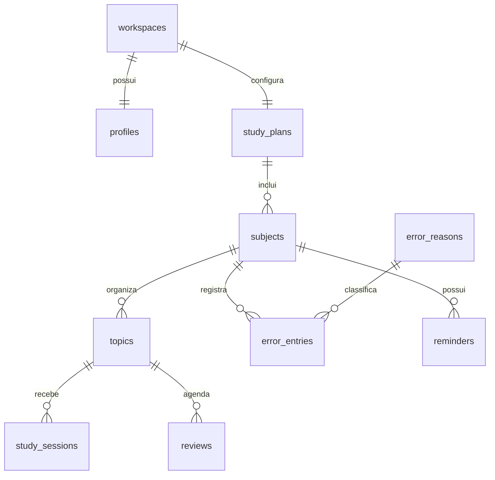

# Banco relacional do Gabarita

O armazenamento é relacional: não existem colunas JSON/JSONB, arrays de entidades, EAV ou documentos serializados. Cada entidade tem colunas tipadas, chave primária e relacionamentos explícitos. O JSON enviado pela API é apenas um DTO montado a partir de consultas SQL para manter compatibilidade com as telas.

## Entidades

| Tabela              | Responsabilidade                                                    | Relacionamentos                                     |
| ------------------- | ------------------------------------------------------------------- | --------------------------------------------------- |
| `workspaces`        | Identificação do espaço, versão para concorrência e data de criação | Raiz do espaço                                      |
| `profiles`          | Nome do estudante                                                   | PK/FK `workspace_id`                                |
| `study_plans`       | Concurso-alvo, datas, disponibilidade e configuração                | FK `workspace_id`; um plano por espaço nesta versão |
| `subjects`          | Matérias, pesos, material principal e ordem                         | FK `plan_id`                                        |
| `topics`            | Tópicos, estado da leitura, domínio e ordem                         | FK `subject_id`                                     |
| `study_sessions`    | Data, minutos, recuperação, questões, acertos e tipo                | FK `topic_id`                                       |
| `reviews`           | Vencimento, intervalo e conclusão                                   | FK `topic_id`                                       |
| `error_reasons`     | Catálogo de causas dos erros                                        | Rótulo único                                        |
| `error_entries`     | Assunto livre da questão, regra aprendida, fonte e resolução        | FKs `subject_id` e `reason_id`                      |
| `reminders`         | Conteúdo, tipo e sequência de acertos                               | FK `subject_id`                                     |
| `schema_migrations` | Controle técnico das migrações e checksum                           | Não contém dados de estudo                          |



O `subject_id` de uma sessão ou revisão não é armazenado novamente: é obtido pelo tópico. O `workspace_id` dos registros de estudo é obtido pelo plano. A prioridade de um lembrete é calculada por `streak < 3`, sem uma segunda coluna que possa divergir. Causas dos erros são normalizadas em um catálogo e reutilizadas por chave estrangeira.

`error_entries.topic_label` é uma descrição livre da questão, preservada do sistema anterior; não representa um tópico cadastrado nem finge ser uma relação por nome. A ligação obrigatória é com a matéria. Um vínculo opcional com tópico cadastrado poderá ser acrescentado quando existir esse recurso na interface.

Os campos `position` preservam a ordem antiga e usam sequências para novos registros, sem consultar `MAX()` do histórico a cada inserção. UUIDs existentes são mantidos. Datas de estudo usam `date`; metadados de criação usam `timestamptz`. Horas, pesos e minutos aceitam frações, preservando os valores aceitos pela versão anterior.

## Integridade e consultas

- Todas as chaves estrangeiras têm índice com a coluna dependente à esquerda.
- Matérias: índice por plano, peso decrescente e ordem.
- Tópicos: índice por matéria e ordem.
- Sessões: índices por tópico/data e por data.
- Revisões: índice parcial para pendências por vencimento e unicidade parcial de `(topic_id, interval_days)` enquanto pendente.
- Erros: índices por matéria/data, causa e pendências.
- Lembretes: índices por matéria e por prioridade (`streak < 3`).

O banco verifica intervalos válidos, pesos, horas, duração, conteúdo obrigatório e `0 <= correct <= questions <= 1000`. Chaves estrangeiras impedem órfãos. Exclusões de entidades proprietárias usam cascata; exclusão de causas em uso é restringida. Não há endpoint de exclusão exposto na interface atual.

Comandos gravam apenas as linhas afetadas, dentro de uma transação. Um bloqueio `FOR UPDATE` na linha de metadados do espaço e a versão recebida impedem sobrescritas concorrentes. A leitura do DTO usa uma transação `REPEATABLE READ` para não misturar estados de instantes diferentes. O número de consultas da leitura é fixo, sem uma consulta adicional para cada matéria ou tópico.

O endpoint de compatibilidade `/api/state` ainda retorna o histórico completo para a interface existente. O armazenamento e as escritas são relacionais; paginação de históricos extensos é uma evolução independente. Índices ajudam as consultas seletivas; com poucas linhas, o PostgreSQL pode preferir corretamente uma varredura sequencial. Não há promessa de ganho medido sem um volume representativo.

Veja `docs/consultas.sql` para relatórios diretos no DBeaver.

## Migração e operação

```sh
pnpm db:migrate
```

A migração `migrations/0001_relational.sql` é versionada e executada pelo runner `server/migrate.ts`. O SQL e o schema Drizzle descrevem as mesmas tabelas de aplicação. `schema_migrations` é mantida exclusivamente pelo runner.

Para a instalação anterior, o runner:

1. Obtém um bloqueio de migração e bloqueia a tabela antiga.
2. Renomeia temporariamente a tabela legada dentro da transação.
3. Cria as tabelas relacionais e importa cada entidade com seus IDs e valores.
4. Reconstrói o DTO e compara **todos os campos, a versão e a ordem** com o documento original de cada espaço.
5. Ajusta as sequências, remove a tabela legada e registra o checksum.
6. Confirma a transação somente se todas as verificações forem bem-sucedidas.

Dados inconsistentes, duplicados ou incompatíveis abortam tudo; não são descartados nem corrigidos silenciosamente. Em instalação vazia, cria apenas o schema; o primeiro acesso inicializa o espaço e as 16 matérias. Reexecuções não reimportam nem duplicam dados. Não edite uma migração aplicada: crie uma nova migração e amplie o runner. O antigo `db:push` foi removido para não contornar a transformação de dados.

Antes da troca no ambiente em uso, pare a aplicação antiga e faça `pg_dump`. O backup desta atualização está em `backups/` (ignorado pelo controle de versão e pelo Docker). Para recuperação, restaure o dump em um banco separado e use a versão anterior da aplicação; não sobrescreva o banco atual sem verificar o backup. A reversão automática da transação cobre falhas durante a migração, não alterações posteriores feitas pelo usuário.

## DBeaver

A conexão permanece `localhost:5442`, banco `gabarita`, usuário `gabarita`. Atualize **Schemas → public → Tabelas** com F5. Abra o diagrama ER selecionando as tabelas: as linhas do diagrama serão obtidas das chaves estrangeiras reais. `workspaces` continua existindo, agora somente com metadados; a coluna `data` foi removida.
